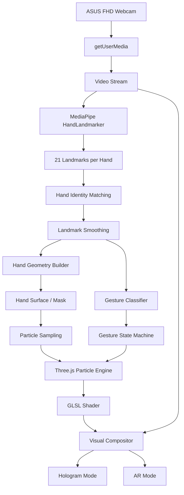

# Gesture Particle System
## 产品需求、技术架构与开发实施规格说明书

**项目名称：** Gesture Particle System  
**项目类型：** Web 实时手势识别与粒子视觉交互系统  
**文档版本：** V1.0  
**开发目标：** 展示级交互作品  
**目标平台：** Windows 11 + Chrome / Edge  
**核心技术：** MediaPipe + Three.js + GLSL + TypeScript

---

# 0. 给开发 Agent 的重要说明

本文档是本项目的核心需求和技术约束文件。

开发 Agent 必须首先完整阅读本文档，再开始修改或创建项目文件。

如果本文档与 Agent 自己的默认实现习惯存在冲突，以本文档明确规定的产品需求和技术约束为准。

本项目不是普通的手势识别 Demo，也不是单纯使用手势控制一个粒子场。

**核心目标是：利用普通电脑摄像头实时捕捉用户的双手，将手掌和手指本身转化为具有空间纵深感的霓虹粒子结构，并通过真实手部动作控制粒子形态，同时提供多种粒子特效和视觉展示模式。**

开发时必须遵循以下原则：

1. 先检查现有开发环境和项目目录，不要直接覆盖用户已有文件。
2. 严格按照本文档的开发阶段推进。
3. 每个阶段完成后必须运行、测试和验证。
4. 不允许一次性生成整个项目的全部功能。
5. 不允许只实现视觉效果而忽略真实摄像头手势识别。
6. 不允许把普通的关键点粒子化冒充完整的手部表面粒子化。
7. 不允许将二维轮廓近似描述成真实的三维深度扫描。
8. 优先保证双手追踪稳定性和交互流畅度，再增加视觉特效。
9. 不得未经核实直接复制没有明确许可证的第三方代码。
10. 每个阶段结束时提供修改说明、测试结果和下一阶段计划。

---

# 1. 项目背景与产品定位

## 1.1 项目构想

本项目希望实现一种基于自然手势的实时粒子交互体验。

用户只需要打开电脑浏览器，授权摄像头，就能够通过双手控制屏幕中的粒子结构。

系统需要识别：

- 手掌位置。
- 手指位置和弯曲程度。
- 手部运动方向。
- 双手之间的相对距离。
- 常见手势状态。

然后将这些数据映射到 Three.js 粒子系统中。

最终形成一个类似科幻电影中全息交互界面的视觉效果。

## 1.2 产品核心定位

本项目由三个核心系统组成：

**A. 手部感知系统**

通过普通 RGB 摄像头获取视频，使用 MediaPipe 实时识别双手，输出手部关键点。

**B. 手部粒子化系统**

根据手部关键点构建手掌和手指的近似表面几何，再将几何结构转化为大量粒子。

粒子必须能够持续跟随手部动作，而不是只在指尖附近产生装饰性粒子。

**C. 手势交互系统**

根据手势状态和双手运动，控制粒子聚集、扩散、旋转、连接和爆发。

## 1.3 产品最终效果

预期视觉特征：

- 黑色或深色背景。
- 蓝色、紫色、青色霓虹粒子。
- 双手由大量细密粒子构成。
- 关节位置具有明显高亮效果。
- 手指和手掌具有空间纵深感。
- 粒子随着手部动作实时变形。
- 张掌、握拳、捏合产生不同特效。
- 双手之间可以形成能量连接。
- 支持全息粒子模式和 AR 增强现实模式切换。

---

# 2. 用户环境与硬件约束

## 2.1 现有硬件

| 硬件 | 配置 |
|---|---|
| 操作系统 | Windows 11 |
| CPU | Intel Core i7-14650HX |
| GPU | NVIDIA RTX 5060 Laptop 8GB |
| RAM | 16GB |
| 摄像头 | ASUS FHD Webcam |
| 浏览器 | Chrome / Edge |

## 2.2 硬件使用要求

项目必须在现有硬件基础上完成。

不允许将以下设备作为必要条件：

- Leap Motion。
- Kinect。
- Intel RealSense。
- 外置深度摄像头。
- 专用手势传感器。

普通 FHD RGB 摄像头必须能够完成第一版的双手识别。

## 2.3 性能定位

目标硬件能够承担：

- 双手实时识别。
- Three.js 三维渲染。
- 2万至3万个初始实验粒子。
- GLSL 粒子动画。
- 基础发光与后处理效果。

性能目标：

| 指标 | 目标 |
|---|---|
| 粒子数量 | 初始总量20,000～30,000 |
| 渲染帧率 | 目标60 FPS |
| 最低可接受帧率 | 30 FPS |
| 手部识别 | 同时支持两只手 |
| 摄像头分辨率 | 初始640×480，可调整至720p |
| 交互延迟 | 尽量保持低延迟，实际测量 |
| 运行方式 | 浏览器本地运行 |

以上为设计目标，不代表未经测试即可保证。

必须根据真实运行情况调整粒子数量、摄像头分辨率和后处理质量。

---

# 3. 核心功能需求

## 3.1 双手实时识别

使用 MediaPipe Hand Landmarker。

每只手输出：

- 21个手部关键点。
- 关键点二维归一化坐标。
- 关键点相对深度。
- 估计的三维世界坐标。
- 左右手分类信息。
- 相关检测置信度（根据实际 SDK 输出）。

配置最大识别手数：

`numHands = 2`

系统必须能够处理：

1. 没有手进入画面。
2. 一只手进入画面。
3. 两只手同时进入画面。
4. 一只手暂时离开画面。
5. 两只手交叉或接近。
6. 手部快速移动。
7. 手指发生遮挡。

必须实现跨帧手部身份匹配，不能简单认为 MediaPipe 返回数组的第一个元素永远代表左手。

建议结合 handedness、手掌中心位置和上一帧的空间位置进行匹配。

## 3.2 手部骨骼可视化

每只手由21个关键点组成。

需要实现：

- 关键点粒子。
- 关键点之间的连接线。
- 指尖高亮。
- 手腕和掌心高亮。
- 骨骼结构随手指弯曲实时变化。

骨骼可视化既是最终视觉效果的一部分，也是开发阶段的重要 Debug 工具。

## 3.3 手部表面粒子化

这是本项目最重要的功能。

必须让手掌和手指本身呈现出密集的粒子结构。

不能仅仅在21个关键点附近添加随机粒子。

第一版需要采用程序化手部表面近似建模方案：

1. 使用21个关键点确定手掌和手指的结构。
2. 使用手掌关键点构建手掌区域。
3. 使用手指骨骼关键点构建五根手指的胶囊状或曲线状区域。
4. 将这些区域组成连续的手部轮廓。
5. 在手部区域内部或近似表面均匀采样粒子。
6. 为每个粒子分配稳定的局部参数。
7. 根据关键点变化更新粒子位置。
8. 通过估计的深度坐标和人为厚度偏移增加空间感。

粒子必须具有稳定身份。

不允许每一帧都完全随机重新生成粒子，否则会产生明显闪烁。

推荐采用固定随机种子、固定采样参数和连续插值。

### 手部几何实现建议

手掌：

使用掌根和指根关键点形成手掌多边形，并通过三角剖分或其他稳定的几何方式填充。

手指：

根据每根手指的关节链构建连续的胶囊或管状近似结构。

粒子：

在手掌和手指区域分配不同密度的粒子。

关键点：

在关节和指尖额外放置高亮粒子。

### 深度说明

普通 RGB 摄像头没有真实的逐像素深度数据。

MediaPipe 提供的 worldLandmarks 是估计的21个关键点三维坐标，不等于完整的手部皮肤网格。

因此第一版的目标是构建具有纵深感的2.5D全息粒子手。

后续可以升级为更加精细的程序化三维手部模型。

不得将第一版宣传为真实三维扫描。

---

# 4. 手势交互设计

基础手部动作同步必须始终运行。

无论粒子处于什么特效状态，手掌移动、手指弯曲和手部位置变化都必须持续反映在粒子结构中。

特效只能改变粒子的附加运动，不能中断基础追踪。

## 4.1 张开手掌

触发条件：

- 多根手指处于伸展状态。
- 手指之间具有一定展开程度。
- 手势持续一段时间，避免瞬间误判。

粒子效果：

- 粒子从手掌向外扩散。
- 指尖产生粒子拖尾。
- 手掌外围形成蓝紫色能量波。
- 扩散结束后，粒子仍然保持手部形态同步。

## 4.2 握拳

触发条件：

- 多根手指向掌心弯曲。
- 指尖与掌心距离缩短。
- 手势持续一段时间。

粒子效果：

- 粒子向掌心聚集。
- 手掌中心形成高亮能量核心。
- 握拳越紧，聚集效果越明显。
- 松开手后逐渐恢复原始手部粒子结构。

## 4.3 拇指与食指捏合

触发条件：

计算拇指指尖和食指指尖的距离，并根据手掌尺寸进行归一化。

建议使用两个不同阈值：

- Pinch ON：进入捏合状态。
- Pinch OFF：退出捏合状态。

避免使用单一阈值导致手势反复抖动。

粒子效果：

- 粒子向捏合点聚集。
- 捏合点形成高亮能量球。
- 松开时产生向外扩散的粒子效果。

捏合也可以作为后续粒子模式切换的候选交互，但第一版不应让捏合同时承担多个容易冲突的功能。

## 4.4 双手靠近

计算左右手掌中心之间的距离。

距离应当根据手掌尺寸归一化，而不是直接使用屏幕像素。

触发效果：

- 两只手之间出现粒子连接。
- 形成蓝紫色能量桥。
- 两手继续靠近时，连接粒子密度增加。
- 可以出现中心能量核心。

## 4.5 双手分开

触发效果：

- 能量连接逐渐拉伸。
- 达到阈值后断裂。
- 产生向两侧扩散的粒子冲击波。
- 两只手恢复各自独立的粒子状态。

## 4.6 指尖运动轨迹

持续追踪五个指尖。

当指尖快速移动时：

- 生成拖尾粒子。
- 拖尾随时间衰减。
- 根据运动速度调整粒子数量。
- 运动停止后，拖尾逐渐消失。

## 4.7 手势状态机

必须建立独立的 Gesture Classifier。

建议采用：

- 归一化几何特征。
- 多帧连续确认。
- 阈值滞回。
- 手势冷却时间。
- 置信度过滤。

建议初始参数：

| 参数 | 初始建议 |
|---|---|
| 手势确认时间 | 150～250ms |
| 手势释放时间 | 100～200ms |
| 模式切换冷却 | 500～700ms |
| 捏合开启阈值 | 需要根据实测标定 |
| 捏合关闭阈值 | 高于开启阈值 |

所有参数应集中放在配置文件中，方便后续调整。

---

# 5. 视觉风格与展示模式

整体采用 Cyberpunk / Holographic 风格。

## 5.1 颜色规范

主色：

- Cyan：青色。
- Electric Blue：电光蓝。
- Neon Purple：霓虹紫。

辅助色：

- White：高亮关键点。
- Deep Navy：深蓝背景。
- Magenta：少量能量反馈。

视觉要求：

- 黑色背景。
- 粒子具有发光感。
- 不使用过度复杂的装饰。
- 粒子颜色根据位置、速度和手势适当变化。
- 适度加入运动残影、能量流和粒子爆发。

## 5.2 模式一：Hologram

纯黑背景的全息粒子模式。

要求：

- 不显示完整摄像头画面。
- 双手以粒子形式呈现。
- 保留小型摄像头预览窗口。
- 摄像头预览可以隐藏或显示。
- 重点展示手部粒子形态和运动效果。

这是默认展示模式。

## 5.3 模式二：AR

增强现实模式。

要求：

- 摄像头画面作为背景。
- 粒子与真实手部位置对齐。
- 可以显示骨骼线框。
- 粒子覆盖真实手部。
- 保留蓝紫色发光效果。
- 支持双手同时显示。

注意：AR模式的摄像头背景、视频镜像和粒子坐标必须严格对齐。

## 5.4 模式切换

用户可以通过网页 UI 在 Hologram 和 AR 之间自由切换。

切换时：

- 不重新申请摄像头权限。
- 不销毁手部识别实例。
- 不重置手部身份。
- 不中断基础追踪。
- 只改变场景合成方式。

---

# 6. 技术选型

## 6.1 推荐技术栈

| 技术 | 用途 | 选择原因 |
|---|---|---|
| Vite | 项目构建 | 轻量、开发速度快 |
| TypeScript | 业务逻辑 | 类型约束，便于维护 |
| MediaPipe Tasks Vision | 手部识别 | 浏览器端实时推理 |
| Three.js | 三维渲染 | 成熟的 WebGL 生态 |
| GLSL | 粒子 Shader | GPU 粒子视觉效果 |
| CSS | 界面 | 科技风格 UI |
| WebRTC getUserMedia | 摄像头 | 浏览器原生摄像头接口 |

不需要：

- Python 后端。
- Flask。
- FastAPI。
- 数据库。
- 云端 GPU。
- OpenAI API。
- 额外付费模型 API。

本项目是纯前端应用。

## 6.2 MediaPipe

推荐：

`@mediapipe/tasks-vision`

使用：

`HandLandmarker`

主要负责：

- 双手识别。
- 21个关键点输出。
- 左右手分类。
- 视频模式下的连续识别。

使用 VIDEO 模式，并设置最大手数为2。

优先使用浏览器支持的 GPU delegate；失败时提供 CPU fallback。

模型和 WASM 资源应固定版本并正确管理，避免运行时依赖不受控的第三方 CDN。

## 6.3 Three.js

主要负责：

- Scene。
- Camera。
- WebGLRenderer。
- BufferGeometry。
- THREE.Points。
- ShaderMaterial。
- 粒子动画。
- 视频背景纹理。
- 粒子连接和能量效果。

建议将粒子系统独立成模块。

## 6.4 GLSL

主要负责：

- 粒子发光。
- 粒子大小。
- 粒子颜色。
- 粒子扩散。
- 粒子收缩。
- 粒子扰动。
- 运动残影辅助效果。

优先使用 GPU 渲染，避免创建大量独立 DOM 元素。

## 6.5 依赖版本管理

不要直接复制旧项目中的依赖版本。

开发 Agent 应当：

1. 检查官方当前稳定版本。
2. 确认与当前浏览器兼容。
3. 确认 MediaPipe 与 Three.js API 兼容。
4. 固定依赖版本。
5. 生成并保留 package-lock.json。

---

# 7. 系统整体架构

## 7.1 系统数据流



## 7.2 模块职责

### CameraService

负责：

- 摄像头启动。
- 摄像头停止。
- 权限申请。
- 视频流管理。
- 错误处理。

### HandTrackingService

负责：

- MediaPipe 初始化。
- 模型加载。
- 双手检测。
- 输出关键点数据。

### HandIdentityManager

负责：

- 左右手身份关联。
- 跨帧位置匹配。
- 手部消失和重新进入处理。

### LandmarkSmoother

负责：

- 坐标平滑。
- 减少关键点抖动。
- 保留快速运动的响应速度。

建议使用 One Euro Filter 或 EMA。

### HandGeometryBuilder

负责：

- 手掌轮廓构建。
- 手指几何构建。
- 手部表面近似。
- 粒子局部坐标映射。

### GestureClassifier

负责：

- 张掌判断。
- 握拳判断。
- 捏合判断。
- 双手距离判断。
- 手势状态机。

### ParticleEngine

负责：

- 粒子创建。
- 粒子位置更新。
- 粒子颜色。
- 粒子聚集。
- 粒子扩散。
- 粒子爆发。
- 指尖拖尾。

### DisplayController

负责：

- Hologram 模式。
- AR 模式。
- 模式切换。
- 视频背景与粒子场景合成。

### HUDController

负责：

- FPS。
- 手部数量。
- 摄像头状态。
- 当前交互模式。
- 当前手势。
- 粒子数量。
- 性能信息。

---

# 8. 推荐项目目录结构

```text
gesture-particle-system/
├── public/
│   ├── models/hand_landmarker.task
│   └── wasm/
├── src/
│   ├── app/
│   │   ├── App.ts
│   │   └── AppController.ts
│   ├── camera/
│   │   ├── CameraService.ts
│   │   └── CameraConfig.ts
│   ├── vision/
│   │   ├── HandTrackingService.ts
│   │   ├── HandIdentityManager.ts
│   │   ├── LandmarkSmoother.ts
│   │   └── types.ts
│   ├── gestures/
│   │   ├── GestureClassifier.ts
│   │   ├── GestureStateMachine.ts
│   │   ├── GestureConfig.ts
│   │   └── GestureTypes.ts
│   ├── hand/
│   │   ├── HandGeometryBuilder.ts
│   │   ├── HandMaskBuilder.ts
│   │   ├── HandSurfaceSampler.ts
│   │   └── HandSkeleton.ts
│   ├── particles/
│   │   ├── ParticleEngine.ts
│   │   ├── ParticleHand.ts
│   │   ├── ParticleEffects.ts
│   │   ├── ParticleConfig.ts
│   │   └── shaders/
│   │       ├── particle.vert
│   │       └── particle.frag
│   ├── rendering/
│   │   ├── SceneManager.ts
│   │   ├── HologramRenderer.ts
│   │   ├── ARRenderer.ts
│   │   └── DisplayController.ts
│   ├── ui/
│   │   ├── HUDController.ts
│   │   ├── ControlPanel.ts
│   │   └── CameraPreview.ts
│   ├── utils/
│   │   ├── CoordinateUtils.ts
│   │   ├── MathUtils.ts
│   │   └── PerformanceMonitor.ts
│   ├── styles/main.css
│   └── main.ts
├── tests/
│   ├── gestures/
│   ├── hand/
│   └── utils/
├── index.html
├── package.json
├── package-lock.json
├── tsconfig.json
├── vite.config.ts
└── README.md
```

以上是推荐结构。

开发 Agent 可以根据实际实现适当调整，但必须保持模块职责清晰，不允许把所有业务逻辑都堆积在 main.ts 中。

---

# 9. 坐标系统与数据管理

这是项目非常重要的技术细节。

必须建立统一的坐标约定。

## 9.1 摄像头坐标

MediaPipe 输出：

- x：归一化横坐标。
- y：归一化纵坐标。
- z：相对深度。

原始坐标范围中：

- 左上角为原点。
- x 向右增加。
- y 向下增加。

## 9.2 镜像处理

建议内部识别和计算始终使用未镜像的原始视频坐标。

镜像只在最终显示层处理。

否则容易出现：

- 骨骼位置和真实手部相反。
- 左右手标签混乱。
- 捏合距离计算异常。
- AR 粒子覆盖错位。

左右手分类必须结合输入是否镜像进行理解。

## 9.3 数据结构建议

统一每帧手部数据：

```typescript
interface HandFrame {
  id: string;
  handedness: "Left" | "Right" | "Unknown";
  confidence: number;
  landmarks: { x: number; y: number; z: number }[];
  worldLandmarks?: { x: number; y: number; z: number }[];
  palmCenter: { x: number; y: number; z: number };
  timestamp: number;
}
```

所有模块使用统一的数据结构。

不要让 ParticleEngine 直接依赖 MediaPipe 的原始返回对象。

---

# 10. 粒子系统技术设计

## 10.1 粒子数据结构

每个粒子需要维护：

- position。
- velocity（需要运动模拟时）。
- color。
- size。
- opacity。
- lifetime（仅用于临时特效粒子）。
- handId。
- surfaceRegion。
- localParameter。

其中 handId 用于区分左右手。

## 10.2 粒子来源

粒子分为三类：

A. 手部表面粒子。

构成手掌和手指的主要轮廓。

B. 关节高亮粒子。

分布在21个关键点附近。

C. 特效粒子。

用于拖尾、爆发、扩散和双手连接。

三类粒子必须分开管理。

## 10.3 粒子更新策略

手部表面粒子应当保持稳定的局部身份。

不能每帧重新随机生成所有粒子。

建议：

- 使用固定随机种子。
- 预先生成粒子局部参数。
- 每帧根据当前关键点更新粒子位置。
- 使用连续插值。
- 对临时粒子使用独立生命周期。

## 10.4 GPU 渲染

推荐：

```text
THREE.BufferGeometry
      ↓
THREE.Points
      ↓
ShaderMaterial
      ↓
Vertex Shader
      ↓
Fragment Shader
      ↓
GPU Rendering
```

建议采用：

- Additive Blending。
- 适当的 Point Size。
- 粒子透明度衰减。
- 颜色渐变。
- 深度写入优化。
- 适当的 Bloom 后处理。

初期可以通过 TypedArray 更新粒子位置。

后续再评估使用 DataTexture 或 Uniform 将关键点传入 Shader，在 GPU 中计算粒子位置。

不要一开始就引入复杂的 GPU 物理模拟。

---

# 11. UI 与交互布局

界面采用暗色科技风格。

主要区域：

1. 顶部系统状态栏。
2. 中央粒子展示区域。
3. 摄像头预览窗口。
4. 左右手识别状态。
5. 模式切换按钮。
6. 粒子效果控制面板。
7. 性能状态面板。

## 11.1 顶部状态栏

显示：

- GESTURE PARTICLE SYSTEM。
- SYSTEM STATUS。
- CAMERA STATUS。
- 当前模式。

## 11.2 主展示区域

占据网页主要面积。

默认使用 Hologram 模式。

## 11.3 摄像头窗口

默认小窗口预览。

提供显示/隐藏控制。

## 11.4 参数面板

建议提供：

- 粒子密度。
- 粒子大小。
- 发光强度。
- 粒子颜色。
- 拖尾长度。
- 粒子扩散强度。
- 特效开关。

第一版不需要实现过多参数，但应预留扩展能力。

## 11.5 手势说明

界面中提供简单的操作提示：

```text
OPEN PALM       → EXPAND
CLOSED FIST     → IMPLODE
PINCH           → GATHER
TWO HANDS NEAR  → ENERGY LINK
TWO HANDS APART → ENERGY BURST
```

---

# 12. 性能优化要求

必须关注：

1. MediaPipe 推理耗时。
2. Three.js 渲染耗时。
3. GPU 粒子数量。
4. 摄像头分辨率。
5. 浏览器设备像素比。
6. 内存占用。
7. 粒子更新时的对象分配。

建议：

- 避免每帧创建大量临时对象。
- 使用 TypedArray。
- 复用 BufferGeometry。
- 使用稳定的粒子索引。
- 摄像头帧率和渲染帧率分开管理。
- 不需要每个渲染帧都重新执行一次手部识别。
- 优先使用新视频帧触发推理。
- 根据设备性能动态调整质量。

建议设计三个质量档位：

| 档位 | 粒子数量 | 特效 |
|---|---:|---|
| Low | 8,000 | 关闭复杂 Bloom |
| Medium | 20,000 | 基础发光 |
| High | 30,000 | 发光、拖尾、完整特效 |

具体数量允许根据实测调整。

如果帧率下降：

1. 降低粒子数量。
2. 降低摄像头推理分辨率。
3. 降低设备像素比。
4. 关闭部分后处理。
5. 降低非关键动画的更新频率。

必须保证手部跟踪优先级高于装饰性特效。

---

# 13. 摄像头、权限和隐私

## 13.1 摄像头权限

必须由用户点击 Start Camera 后才申请摄像头权限。

不能在页面加载时自动打开摄像头。

## 13.2 摄像头停止

点击 Stop Camera 后：

- 停止所有 MediaStreamTrack。
- 停止手部识别循环。
- 清理视频资源。
- 释放不再使用的 GPU 资源。
- 更新系统状态。

## 13.3 错误处理

必须考虑：

- 摄像头不存在。
- 摄像头被其他程序占用。
- 用户拒绝权限。
- 浏览器不支持摄像头接口。
- MediaPipe 模型加载失败。
- WASM 加载失败。
- GPU delegate 初始化失败。
- WebGL 不可用。

GPU 初始化失败时应尝试 CPU fallback。

## 13.4 隐私

本项目默认采用纯本地处理：

- 摄像头数据不上传服务器。
- 不建立视频上传接口。
- 不保存用户视频。
- 不需要用户账号。
- 不需要云端推理服务。

部署环境必须支持 HTTPS，开发环境可以使用 localhost。

模型和 WASM 首次获取时可以从官方资源下载，之后应尽可能使用本地静态资源。

---

# 14. GitHub 开源项目参考

这些项目用于学习实现思路，不要求直接 Fork 某一个项目。

开发 Agent 必须在实际复用之前检查：

- 当前仓库是否存在。
- README 是否更新。
- 实际代码是否符合描述。
- package.json 中的依赖。
- LICENSE。
- 是否存在废弃 API。
- 是否能在当前浏览器运行。

## 14.1 Gesture Particles

地址：https://github.com/naoufalnajim01/gesture-particles

参考价值：

- MediaPipe 双手追踪。
- 每只手21个关键点。
- Three.js 粒子系统。
- GLSL Shader。
- 粒子颜色渐变。
- 黑色背景全息效果。

重要限制：

该项目通过关键点附近的粒子构建手部视觉，并不等于已经生成了完整的手部表面网格。

项目 README 声明采用 MIT License。

**建议：重点研究其粒子渲染和手部坐标映射。**

## 14.2 HoloFlux Gesture Engine

地址：https://github.com/ossamamehmood/holoflux-gesture-engine

参考价值：

- GPU 粒子物理。
- GLSL Shader。
- 粒子爆发。
- 粒子聚集。
- 张掌和握拳的交互。
- 手势状态机。
- Web Audio API。

重要限制：

它主要是手势控制一个独立粒子场，而不是将手本身转化为粒子。

项目 README 声明采用 MIT License。

**建议：重点研究其粒子特效和手势状态管理。**

## 14.3 Particle Handtracker

地址：https://github.com/FIQTOR/particle-handtracker

参考价值：

- MediaPipe Hand Landmarker。
- Three.js。
- GPU 粒子。
- 约25,000个粒子。
- GLSL。
- 粒子形态转换。
- 摄像头交互。

重要限制：

粒子主要组成球体、心形、花朵等参数化模型，而不是手部表面点云。

项目 README 声明采用 MIT License。

**建议：研究其粒子数量管理、Shader 和粒子形态转换。**

## 14.4 Hand FX

地址：https://github.com/jztrxn/hand-fx-tool

参考价值：

- MediaPipe HandLandmarker。
- 双手识别。
- Landmark-derived Hand Mask。
- Three.js。
- One Euro Filter。
- GPU delegate 和 CPU fallback。
- 指尖粒子拖尾。

特别值得研究的是：

它使用21个关键点绘制手掌多边形，并通过有宽度的手指骨骼线生成手部 Mask。

这与我们第一版的手部轮廓建模方案高度相关。

重要限制：

此前检查时没有发现明确的 LICENSE 文件。

因此只能参考其公开技术思路，不得直接复制代码，除非后续确认获得合法授权或明确许可证。

## 14.5 Gesture Sculpt

地址：https://github.com/georgiahoffmann/gesture-sculpt

参考价值：

- 手势识别模块化。
- Landmark 平滑。
- 手势分类。
- 双手交互设计。

许可证和当前代码状态需要开发 Agent 再次核实。

**建议：作为架构设计的候选参考，不作为必要依赖。**

## 14.6 HoloHand 2035

地址：https://github.com/rohullahr914-pixel/HoloHand-2035

参考价值：

- 双手关键点追踪。
- HUD 界面。
- 科技风格。
- 粒子和线框视觉。

许可证和当前代码状态需要再次核实。

**建议：仅用于视觉和界面设计参考。**

## 14.7 补充参考：HoloHand

地址：https://github.com/HussnainZahid/HoloHand

参考价值：

- TypeScript。
- Three.js。
- MediaPipe。
- 模块化架构。
- 手势稳定处理。
- HUD 和三维点云展示。

注意检查具体实现、项目实际完成度以及 LICENSE 后再决定是否复用。

---

# 15. 官方技术文档

开发时优先使用官方文档，不要只根据 GitHub 示例编写代码。

- MediaPipe Hand Landmarker：https://developers.google.com/edge/mediapipe/solutions/vision/hand_landmarker
- Three.js：https://threejs.org/docs/
- Vite：https://vite.dev/guide/
- TypeScript：https://www.typescriptlang.org/docs/
- WebRTC getUserMedia：https://developer.mozilla.org/en-US/docs/Web/API/MediaDevices/getUserMedia
- WebGL：https://developer.mozilla.org/en-US/docs/Web/API/WebGL_API

---

# 16. 分阶段开发计划

必须严格按照阶段执行。

每个阶段完成后先测试，确认通过，再进入下一阶段。

## Phase 0：环境检查与项目初始化

任务：

1. 检查 Windows 环境。
2. 检查 Node.js。
3. 检查 npm。
4. 检查 Chrome / Edge。
5. 创建 Vite + TypeScript 项目。
6. 安装 MediaPipe Tasks Vision。
7. 安装 Three.js。
8. 建立基础目录结构。
9. 确保项目能够启动和构建。

验收标准：

- npm install 成功。
- npm run dev 成功。
- 浏览器能够打开网页。
- npm run build 成功。

## Phase 1：摄像头与双手识别

任务：

1. 实现摄像头启动和停止。
2. 加载 MediaPipe Hand Landmarker。
3. 设置最多识别两只手。
4. 获取21个关键点。
5. 显示骨骼结构。
6. 显示手部数量。
7. 显示左右手状态。
8. 实现坐标镜像和调试。
9. 实现关键点平滑。

验收标准：

- 浏览器能够正常申请摄像头。
- 可以识别一只手。
- 可以同时识别两只手。
- 手指移动时骨骼结构实时跟随。
- 手部短暂离开画面后能够重新识别。
- 停止按钮能够释放摄像头。
- 没有明显坐标错位。

## Phase 2：手部表面粒子化

任务：

1. 建立手掌轮廓。
2. 建立手指近似几何。
3. 实现粒子采样。
4. 形成完整手部粒子结构。
5. 实现双手独立粒子系统。
6. 加入粒子跟随。
7. 加入颜色渐变。
8. 加入关键点高亮。

验收标准：

- 手掌具有连续粒子填充。
- 五根手指具有明显粒子结构。
- 粒子不只是集中在21个关键点附近。
- 手指弯曲时粒子结构能够同步变化。
- 手掌移动时粒子手整体跟随。
- 粒子不存在严重闪烁。

## Phase 3：手势交互

任务：

1. 张掌识别。
2. 握拳识别。
3. 捏合识别。
4. 双手距离检测。
5. 手势状态机。
6. 粒子扩散。
7. 粒子聚集。
8. 能量连接。
9. 连接断裂和爆发。
10. 指尖拖尾。

验收标准：

- 常见手势能够稳定触发。
- 不会频繁误触。
- 特效过程中基础动作同步不中断。
- 双手可以独立控制。
- 双手靠近和分开能够触发对应效果。

## Phase 4：视觉与模式切换

任务：

1. Hologram 模式。
2. AR 模式。
3. 模式切换。
4. 蓝紫色霓虹风格。
5. 粒子发光。
6. Bloom（如性能允许）。
7. HUD。
8. 摄像头预览。
9. 参数控制面板。
10. 全屏展示。

验收标准：

- 两种模式都能正常显示。
- 模式切换不重启摄像头。
- AR 模式中粒子与手部对齐。
- Hologram 模式中能够清晰看到粒子手。
- UI 不影响核心交互。

## Phase 5：性能优化与发布

任务：

1. 优化粒子更新。
2. 优化 Shader。
3. 优化 MediaPipe 推理。
4. 加入质量档位。
5. 加入 FPS 监控。
6. 测试不同环境。
7. 完成生产构建。
8. 部署网页。

验收标准：

- 无持续内存泄漏。
- 摄像头能够正常启停。
- 双手追踪稳定。
- 正常场景下尽量达到60 FPS。
- 性能较低时能够降级运行。
- 生产环境能够正常申请摄像头权限。

---

# 17. 测试矩阵

每个阶段都应进行测试。

| 测试场景 | 预期结果 |
|---|---|
| 无手进入画面 | 正常显示等待状态 |
| 单手进入 | 正常显示一只粒子手 |
| 双手进入 | 同时显示两只粒子手 |
| 左右手交叉 | 不应频繁交换身份 |
| 快速移动 | 粒子能够跟随 |
| 张开手掌 | 粒子扩散 |
| 握拳 | 粒子聚集 |
| 捏合 | 粒子向指尖聚集 |
| 双手靠近 | 出现能量连接 |
| 双手分开 | 能量连接断裂 |
| 切换 Hologram | 黑色背景粒子模式 |
| 切换 AR | 摄像头叠加模式 |
| 拒绝摄像头权限 | 显示错误提示 |
| 停止摄像头 | 释放视频流 |
| GPU delegate 失败 | 尝试 CPU fallback |
| 粒子数量过高 | 自动降低质量 |

---

# 18. Codex 开发执行规范

本项目将使用 Codex 或其他编程 Agent 辅助开发。

开发 Agent 必须遵守以下约束。

## 18.1 不要一次性完成全部功能

必须逐阶段开发。

每完成一个阶段：

- 检查文件。
- 运行项目。
- 执行构建。
- 检查错误。
- 验证功能。
- 更新 README。
- 总结修改。

未经验证不得进入下一阶段。

## 18.2 保留已验证功能

修改已有代码前：

1. 先阅读相关文件。
2. 理解模块之间的依赖。
3. 尽量采用局部修改。
4. 不要随意重写整个项目。
5. 不要删除已经完成的功能。

## 18.3 不允许虚报测试结果

如果没有实际运行测试，必须明确说明。

不允许只凭代码看起来正确就声称已经完成。

## 18.4 每个阶段提交说明

每次开发结束，向用户报告：

1. 本阶段完成了什么。
2. 修改了哪些文件。
3. 使用了哪些技术。
4. 如何运行。
5. 如何测试。
6. 测试是否通过。
7. 当前还存在什么问题。
8. 下一阶段计划。

## 18.5 优先级

开发优先级：

```text
真实手部识别
  > 手部粒子形态
  > 基础动作同步
  > 手势识别
  > 粒子特效
  > 视觉界面
  > 装饰性功能
```

不要为了增加视觉效果牺牲基础追踪质量。

---

# 19. 第一阶段 Codex 启动任务

以下是可以直接交给 Codex 的第一条任务指令。

请注意：这条指令只允许完成 Phase 0 和 Phase 1，不允许提前实现后面的粒子系统。

---

## Codex Prompt

你现在负责开发 Gesture Particle System 项目。

请首先完整阅读项目根目录中的 DEVELOPMENT_SPEC.md。

本文档是项目的唯一核心需求说明。

### 当前任务

只执行：

- Phase 0：环境检查与项目初始化。
- Phase 1：摄像头与双手识别。

不要提前实现粒子系统、手部表面粒子化、复杂特效或完整 UI。

### 第一步：环境检查

检查：

- 当前项目目录。
- Windows 环境。
- Node.js。
- npm。
- 浏览器。
- 当前是否已经存在项目文件。

如果当前目录已有文件，先检查再决定如何组织项目。

不得直接删除用户文件。

### 第二步：初始化项目

采用：

- Vite。
- TypeScript。
- MediaPipe Tasks Vision。
- Three.js。

建立合理的项目目录。

安装依赖前检查当前官方稳定版本和 API。

锁定依赖版本。

### 第三步：实现摄像头

实现：

- Start Camera 按钮。
- Stop Camera 按钮。
- 浏览器摄像头权限申请。
- 视频流显示。
- 摄像头错误处理。
- 停止后释放 MediaStreamTrack。

默认使用普通 RGB 摄像头。

### 第四步：实现 MediaPipe 双手识别

配置 HandLandmarker：

- runningMode: VIDEO。
- numHands: 2。

获取：

- 双手21个关键点。
- 左右手分类。
- 估计世界坐标。

必须检查当前安装版本的真实 API 和 TypeScript 类型。

不要凭记忆编造 API 属性。

### 第五步：实现骨骼可视化

在页面中显示：

- 21个关键点。
- 手指骨骼连线。
- 左右手状态。
- 当前识别手数。
- 摄像头运行状态。

支持双手同时显示。

加入简单的关键点平滑。

### 第六步：调试与验收

完成后必须：

1. 运行 npm install。
2. 运行 npm run dev。
3. 检查浏览器控制台。
4. 运行 npm run build。
5. 检查摄像头启停。
6. 测试单手。
7. 测试双手。
8. 测试手指移动。
9. 测试摄像头权限拒绝。

如果当前 Agent 无法直接访问真实摄像头，必须如实说明，并提供用户手动验证步骤，不能声称已经完成真实摄像头测试。

### 最终交付

请提供：

- 当前项目结构。
- 已完成的功能。
- 修改文件列表。
- 安装和启动命令。
- 实际测试结果。
- 尚未解决的问题。
- 下一阶段实施计划。

完成 Phase 0 和 Phase 1 后停止。

等待用户确认，再开始 Phase 2。

---

# 20. 最终产品验收标准

本项目最终必须满足以下核心要求：

1. 不购买额外硬件。
2. 只使用普通电脑摄像头。
3. 在电脑浏览器中运行。
4. 同时识别两只手。
5. 手掌和手指本身由粒子构成。
6. 粒子跟随真实手部运动。
7. 张掌、握拳、捏合具有不同反馈。
8. 双手靠近可以形成能量连接。
9. 双手分开可以产生粒子断裂和爆发。
10. 支持 Hologram 和 AR 两种展示模式。
11. 采用蓝紫青霓虹赛博朋克风格。
12. 具备完整的摄像头启停和错误处理。
13. 在目标硬件上进行实际性能测试。
14. 项目模块化，方便后续扩展。

**最终愿景：**

打开网页，摄像头开始捕捉双手。

屏幕中出现两只由蓝紫色粒子组成的全息手掌。

手掌随着真实动作移动，手指弯曲时粒子结构同步变化。

握拳，粒子向掌心收缩；张掌，粒子向外爆发；双手靠近，能量在两只手之间流动；双手分开，能量连接断裂并产生粒子冲击波。

整个过程实时发生，不需要鼠标，也不需要额外传感器。

这就是 Gesture Particle System 最终需要实现的产品体验。
