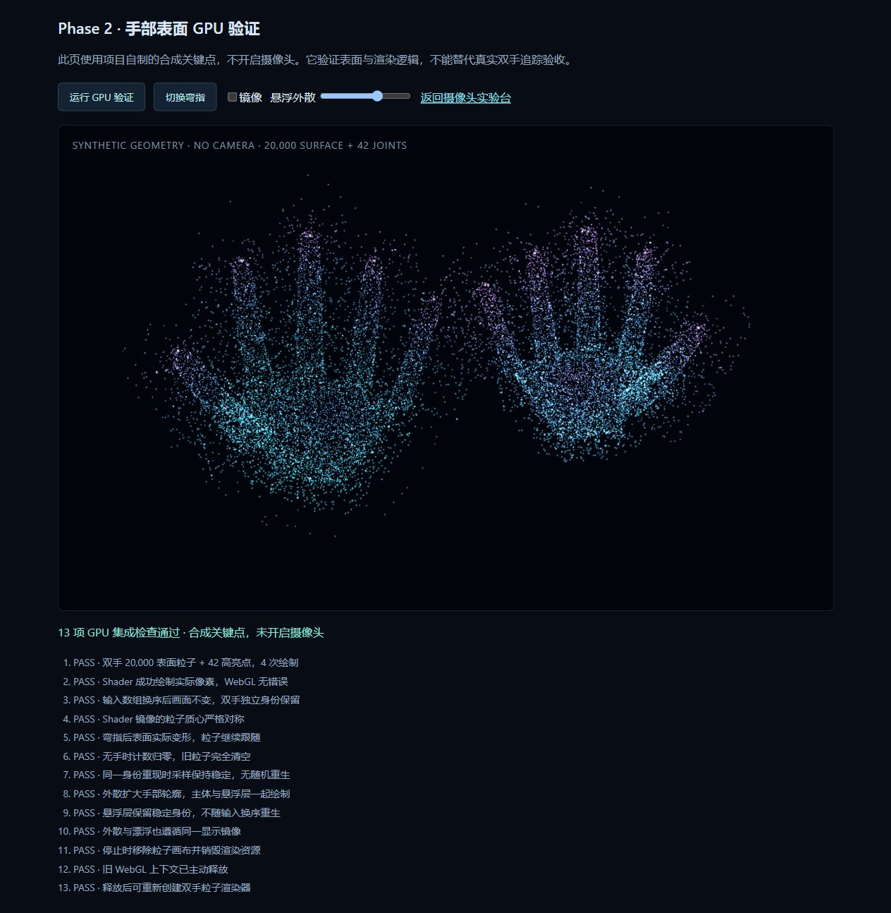

# Gesture Particle System

用普通 RGB 摄像头，将真实双手变成持续跟随动作的蓝紫青粒子结构。

当前版本：**v0.2.0 · Phase 2：手部表面粒子化**。项目由 Vite、TypeScript、MediaPipe Hand Landmarker、Three.js 和 GLSL 构建，全部推理在浏览器本机完成。



*效果图使用项目自制的合成关键点，展示表面与悬浮外散渲染；实际应用由真实摄像头双手驱动，合成测试不替代摄像头验收。*

## 已实现

- 摄像头显式启停、权限/设备错误提示，以及停止后的流和渲染资源清理。
- 同时追踪两只手，每只手 21 个关键点；位置、左右手分类与短期运动共同参与跨帧身份匹配。
- 自适应坐标平滑、骨骼连线、指尖/手腕高亮和关键点编号调试。
- 连续的掌面填充、掌缘厚度、五指曲线管状表面与圆润指尖端盖。
- 每只手 **10,000 个稳定身份的表面粒子 + 21 个关节高亮点**，双手合计 20,042 个点。
- 青、蓝、紫渐变与 GLSL 发光点；粒子跟随手掌移动和手指弯曲，不逐帧重新随机采样。
- 悬浮外散层：外层粒子缓慢漂浮，位移始终依附手部表面；外散幅度可调 0～100%，默认 65%。
- 镜像显示、平滑、表面粒子、骨骼调试、视频参考等独立开关。
- MediaPipe 优先使用 GPU，初始化失败时尝试 CPU；粒子渲染不可用时保留骨骼调试。

普通 RGB 摄像头没有逐像素深度，本项目构建的是 **2.5D 程序化近似手部表面**。MediaPipe 的 worldLandmarks 是估计关键点，不是完整皮肤网格，也不是真实三维扫描。

## 快速开始

建议环境：Node.js **24+**、npm、Windows 11、Chrome / Edge，以及普通电脑摄像头。

```bash
git clone https://github.com/wdy-hh/vibe-coding-lab.git
cd vibe-coding-lab/projects/gesture-particle-system
npm ci
npm run dev
```

打开终端显示的 [http://127.0.0.1:5173/](http://127.0.0.1:5173/)。**务必进入本项目文件夹后再运行 npm**；仓库根目录不是这个应用的 npm 工作目录。

1. 点击 **Start Camera**，允许本地页面访问摄像头。
2. 将一只或两只手放入画面，张掌、移动手掌、弯曲手指，观察表面粒子同步变化。
3. 调整 **悬浮外散**：0% 更贴合表面，65% 为默认漂浮效果，100% 外层更松散。
4. 取消 **视频参考**，可在黑色背景上更清晰地观察粒子；识别继续读取原视频。
5. 开启 **骨骼调试** / **关键点编号**，检查关节位置与视频对齐。
6. 点击 **Stop Camera** 结束体验；开发服务器运行期间保留终端，按 Ctrl+C 结束服务器。

若 5173 端口被占用，请关闭之前启动的开发服务器后再重试。

## 本地模型与 WASM

仓库保留经过 SHA-256 校验的官方 `hand_landmarker.task` 模型。WASM 和加载脚本由 **固定版本的 npm 包**生成，不将生成副本重复提交到 Git。

- `npm run dev` / `npm run build` 前会自动执行 `assets:prepare`，从 `node_modules/@mediapipe/tasks-vision/wasm/` 同步到 `public/wasm/`。
- 模型的固定下载地址、版本、字节数和哈希记录在 [vision-assets.lock.json](vision-assets.lock.json)。
- 模型缺失或损坏时，可执行 `npm run assets:download` 从 Google 官方固定版本地址恢复。
- 完成依赖安装和资源准备后，运行时从本机静态目录加载模型与 WASM，不依赖外部 CDN。

```bash
npm run assets:prepare
# 仅在模型缺失或校验失败时联网恢复
npm run assets:download
```

## 测试与构建

在本项目目录中运行：

```bash
npm test
npm run check
npm run build
npm run preview
```

- `npm test`：Node 内置测试运行器，覆盖摄像头生命周期、身份匹配、平滑、坐标映射与手部表面生成。
- `npm run check`：TypeScript 类型检查。
- `npm run build`：校验本地资源、检查类型并生成 `dist/`。
- `npm run preview`：在 [http://127.0.0.1:4173/](http://127.0.0.1:4173/) 预览生产构建。

开发服务器运行时，可打开 [GPU 合成几何测试页](http://127.0.0.1:5173/tests/browser/surface.html)，点击“运行 GPU 验证”。该页不申请摄像头，只验证真实 WebGL 绘制与表面变形，未作为生产入口发布。

Phase 2 验收记录：**38 项单元测试通过、13 项 GPU 集成检查通过**。真实双手跟随已由用户反馈确认。渲染 60 FPS 是后续性能目标，当前没有持续帧率或端到端延迟保证。详细验证范围见 [测试说明](docs/TESTING.md)。

## 项目结构

```text
gesture-particle-system/
├── src/
│   ├── app/           # 应用调度与生命周期
│   ├── camera/        # 摄像头启停、配置和错误处理
│   ├── vision/        # MediaPipe、身份匹配、平滑、统一数据结构
│   ├── hand/          # 掌面与五指几何、稳定表面采样
│   ├── particles/     # Three.js 粒子缓冲区与 GLSL Shader
│   ├── rendering/     # 骨骼调试覆盖层
│   ├── ui/            # 调试控件与状态显示
│   ├── utils/         # 坐标映射
│   └── styles/
├── public/
│   ├── models/        # 固定版本官方模型
│   └── licenses/      # 第三方许可证
├── scripts/           # 本地资源同步与完整性检查
├── tests/
│   ├── unit/          # 38 项逻辑与几何测试
│   └── browser/       # GPU 集成验证页
├── docs/
│   ├── images/        # 合成关键点效果图
│   ├── ARCHITECTURE.md
│   └── TESTING.md
├── DEVELOPMENT_SPEC.md
├── THIRD_PARTY_NOTICES.txt
├── vision-assets.lock.json
├── package.json
└── package-lock.json
```

生成的 `public/wasm/`、`public/vision-assets.json`、`node_modules/` 和 `dist/` 均不提交。每个项目有独立依赖和启动命令，不需要在仓库根目录安装。

## 架构与开发过程

整体数据流：

```text
摄像头视频 → MediaPipe 双手关键点 → 身份匹配 → 坐标平滑
    → 掌面/五指近似几何 → 固定局部参数采样 → Three.js / GLSL 粒子
```

本项目按阶段由 AI 辅助开发，并由用户参与真实摄像头验证和视觉反馈。当前外散层来自“粒子跟随正常，但希望更科幻、向外发散且继续跟手”的迭代反馈。

- [技术架构与坐标约定](docs/ARCHITECTURE.md)
- [测试范围与手动验收](docs/TESTING.md)
- [完整产品需求、技术约束与阶段计划](DEVELOPMENT_SPEC.md)

## 后续计划

- Phase 3：独立手势分类器与状态机，加入张掌、握拳、捏合和双手能量连接。
- Phase 4：正式 Hologram / AR 展示模式、后处理与展示 UI。
- Phase 5：持续性能测量、质量档位、长时间稳定性验证与部署。

上述为后续开发计划，当前版本尚未实现。任何后续特效都应叠加在持续更新的真实手部表面之上。

## 隐私与许可证

摄像头仅在用户点击后开启，视频在浏览器本机处理；应用没有视频上传、录制、保存、账号或云端推理接口。本地开发可使用 localhost，远程部署需要 HTTPS；请勿通过 `file://` 直接打开页面。

应用代码目前未单独指定许可证。MediaPipe SDK / 官方模型与 Three.js 保留各自许可证，来源与完整许可文本见 [THIRD_PARTY_NOTICES.txt](THIRD_PARTY_NOTICES.txt) 和 [public/licenses](public/licenses)。未复制需求文档中列出的社区演示项目代码。
